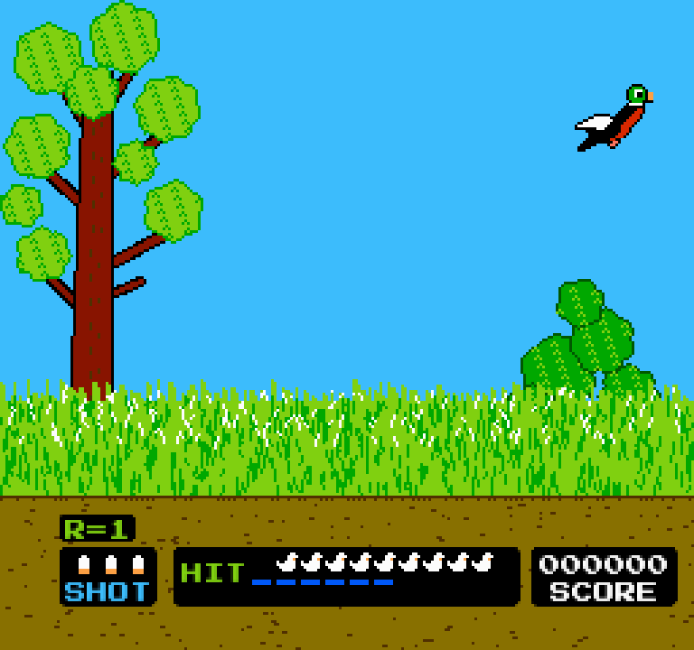
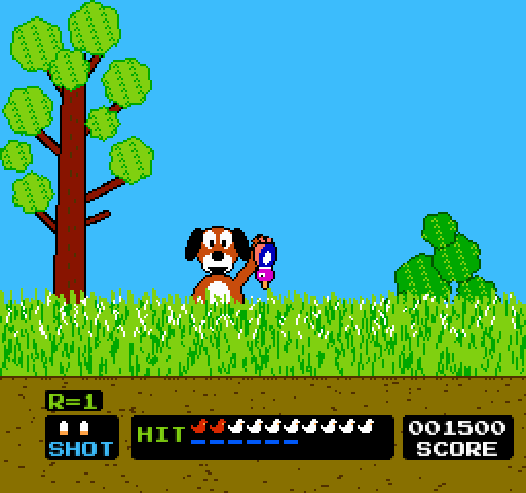

<div align = center>

# Fowl Play

Ducks over a marsh, a dog in the grass and three shells: the light-gun game of
the eighties, played with the mouse, a game controller or a finger. Written in
[pleamar].

 

<sub>*En español: [LEEME.md](LEEME.md).*</sub>

</div>

> [!IMPORTANT]
> **Unofficial fan game.** It is not made, approved or endorsed by Nintendo,
> and contains no file of any other game: every picture is drawn by the scripts
> in `art/`, every sound is a tone made while it runs, and every tune is its
> own. Free to play and to share, **not to be sold**. See [NOTICE.md](NOTICE.md).

## Play

```sh
git clone https://github.com/k4ditano/fowl-play
cd fowl-play
./play.sh
```

It needs [pleamar] 0.4.14 or newer (it brings its own font, and plays its tunes
with notes that keep their time to the sample) and any Wayland compositor. The
window can be as big as you like: the picture, drawn at the console's 256 × 240,
grows a whole number of times and stays sharp.

| | |
| --- | --- |
| **Game A** | one duck at a time, ten to a round |
| **Game B** | two ducks at a time |
| **Game C** | clays, two at a time, thrown away from you |

Three shells for each duck (each pair in B and C). Hit enough of the ten —six
in the first rounds, all ten from round 20— or the round is the last. All ten
are a bonus. The black duck is the slowest and worth the least, the red one the
fastest and worth the most, and they all fly faster each round.

| | |
| --- | --- |
| Mouse | aim and click: the gun |
| Game controller | the left stick aims a sight, A fires, Start pauses |
| Tablet | touch where the duck is (through `pleamar-wm remote`) |
| ↑ ↓ and Enter | choose a game on the title |
| P or Esc | pause; Q, paused, goes back to the title |
| M | sound on or off |
| F | the gun's flash on or off |

**The flash.** When the trigger is pulled the screen goes black for a frame,
then shows the targets as white boxes for one more: that is how the light gun
knew what it was pointed at. Here the mouse already knows, but the flash is
kept because it was part of the game. F turns it off.

## Inside

- `fowl.plm` is the scene: the marsh, the clay range, the board and the
  title, drawn from what the logic says.
- `fowl.luau` and `logic/` are the logic, in steps of a sixtieth of a second
  as the console counted them: `marsh.luau` (the dog and the ducks),
  `range.luau` (the clays), `board.luau` (the board and the end of a round) and
  `music.luau` (the sounds and the tunes, written as notes: `"t150 o5 l8 g e g
  >c4"`).
- `art/make.py` draws every picture into `pieces/`: the ducks letter by letter
  (`ducks.py`), the dog from shapes with an outline round them (`dog.py`), and
  the marsh, the range and the small pieces (`field.py`). `python3 art/make.py
  preview` also writes them six times bigger, to look at.

## Licence

The code and the drawing scripts: MIT ([LICENSE](LICENSE)). The font, Press
Start 2P: SIL Open Font License 1.1 ([fonts/OFL.txt](fonts/OFL.txt)).

[pleamar]: https://github.com/k4ditano/pleamar
